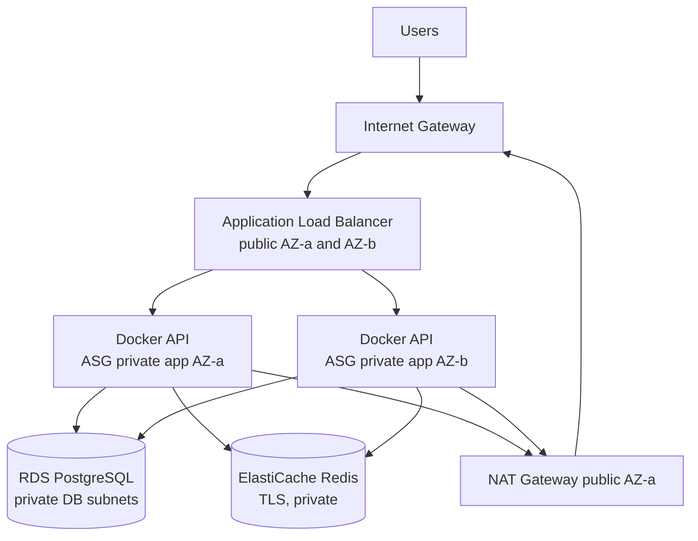

# Architecture Document

## 1. Scope and architecture

This submission implements one AWS target using services I can operate and explain. Terraform creates one VPC across two Availability Zones with two public subnets for an internet-facing Application Load Balancer, two private application subnets for an EC2 Auto Scaling Group, and two isolated private database subnets for RDS PostgreSQL. Application instances run the supplied black-box image in Docker on port 8080. ElastiCache Redis sits in the private application tier. A NAT Gateway provides private-instance egress; no inbound SSH is allowed, and Systems Manager is used for administration.

Implemented code is under `infra/aws`. Items marked "proposed" below are design, not completed evidence.

## 2. Decisions and rejected alternatives

1. **AWS first, instead of claiming cloud agnosticism.** The implementation matches my current VPC, EC2 Auto Scaling, Docker, RDS, networking, and ALB knowledge. A provider-neutral Kubernetes abstraction was rejected for this submission because I could not honestly demonstrate and defend it in the timebox. Proposed next step: separate provider modules for EKS and local kind, with Helm as the application layer.
2. **EC2 Auto Scaling with Docker.** This is simpler to operate and explain than EKS. EKS was rejected for the implemented phase because it adds cluster lifecycle, networking, ingress, workload identity, HPA/KEDA, PDB, and GitOps knowledge not demonstrated here.
3. **Rolling instance refresh.** The ASG keeps 100% minimum healthy capacity; ALB health checks decide when new instances receive traffic. Blue/green was rejected for now because it doubles the full compute fleet and needs automated listener switching. A true canary is proposed when metric gates exist.
4. **Managed RDS and ElastiCache.** Managed backup, failover, patching, and encryption reduce operational risk versus databases on EC2. Self-managed PostgreSQL/Redis were rejected because the team would own replication, failover, and recovery.
5. **Private application and database tiers.** Only the ALB is public. Direct SSH and a public RDS endpoint were rejected to reduce attack surface. Systems Manager provides audited access.
6. **One NAT Gateway for the demonstration.** This saves cost but creates an AZ dependency. Production should provision one NAT per AZ and route each application subnet to its local NAT.
7. **Build once and deploy by digest.** The pipeline resolves `repo@sha256:...` and Terraform rejects tag-only production images. Rebuilding separately per environment was rejected because different bytes could reach production.

## 3. Delivery, zero downtime, and migrations

The implemented workflow builds the API once, scans it, pushes to ECR, and deploys the digest. Terraform creates a new launch-template version and starts an ASG rolling refresh. New instances must pass `/healthz` before receiving traffic. The old container gets up to 75 seconds to stop, matching the stated maximum 60-second job plus margin. ALB target deregistration is 60 seconds.

For the complete platform, the proposed API strategy is a canary: 5% for 5 minutes, 25% for 10 minutes, 50% for 10 minutes, then 100%. Halt and roll back if p95 latency exceeds 400 ms for 5 minutes, HTTP 5xx exceeds 1%, readiness falls below 99%, or the SLO error-budget burn rate is above 14.4x (fast) or 6x (slow). The proposed worker strategy is rolling replacement with queue consumers stopping intake on termination, completing the current job for up to 75 seconds, and acknowledging only after success. Workers are not traffic-canary candidates; compare job error and duration metrics between versions.

Non-backward-compatible startup migrations make genuine zero downtime impossible. The required process is expand/contract: (1) deploy an additive schema migration compatible with old and new code, (2) deploy code that writes/reads both forms, (3) backfill and validate, (4) switch reads, and only in a later release (5) remove the old schema. Rolling application rollback is safe before the contract phase. After destructive migration, restore/forward-fix is required; a container rollback alone is unsafe.

Proposed rollout order: shared development, shared staging, shared production, dedicated internal tenants, dedicated low-risk tenants, high-value tenants, then additional regions. Halt the ring when any tenant fails the same metric gates.

## 4. Scaling, tenancy, reliability, and operations

At 2,250 requests/second, required API instances are `ceil(2250 / measured safe requests per second per instance * 1.30)`. If a load test proves 150 requests/second per instance at p95 <400 ms, this is `ceil(2250/150*1.30) = 20` instances. The ASG maximum is 30 for headroom. The current request-per-target target is a starting point, not proof; tune it with load-test results. Pre-scaling before a known peak is required to guarantee under-five-minute response because EC2 boot plus Docker pull can exceed five minutes. A baked AMI or warm pool is the next optimization.

At 20,000 jobs/hour, average arrival is 5.56 jobs/second. Worst-case 60-second jobs need about `5.56*60 = 334` continuously busy worker slots before headroom; actual concurrency must be based on observed job duration. Proposed worker scaling uses Redis queue depth and oldest-job age via KEDA or CloudWatch custom metrics, not CPU. Scale-in stops intake first and never removes consumers with unacknowledged work.

RDS is likely the first stateful limit. Track CPU, free memory, storage queue depth, read/write latency, connections, locks, and slow queries. Use a bounded connection pool per instance so `instances * pool_size` remains below the database connection budget. Scale vertically/read replicas only after query and index review. Writes and migrations still depend on the primary.

The reusable Terraform variables provide the start of a shared/dedicated template. A complete tenant catalog would drive one isolated state/workspace per tenant, separate encryption keys/secrets, quotas, and region. EU tenant stacks must select only approved EU regions; backups, logs, metrics, and support exports must stay in those regions. Organization Service Control Policies should deny non-EU resource creation for EU accounts. A reviewed tenant manifest change should run plan/apply and health validation in under 30 minutes.

SLOs are 99.9% monthly successful/fast requests for shared (about 43.8 minutes error budget in a 30-day month) and 99.95% for dedicated (about 21.9 minutes). Alert on availability, latency, 5xx, unhealthy targets, ASG capacity, Redis queue age/depth, failed jobs, RDS storage/connections/CPU, backup failures, and certificate expiry. Every metric/log should include environment and tenant ID without recording secrets or personal data. Runbooks are in `docs/runbook.md`.

Backups: keep automated RDS backups for 14 days in production, Redis snapshots for 7 days, and copy only within the tenant's legal region boundary. Quarterly, restore RDS to a new isolated instance, run schema/integrity checks, measure recovery time, and delete it after evidence is approved. Define RPO/RTO with the business; a proposed starting point is RPO <= 5 minutes and RTO <= 60 minutes.

## 5. Cost, risks, and 90-day plan

Indicative monthly steady-state components are two small EC2 instances, ALB and capacity units, one NAT Gateway plus data processing, Multi-AZ RDS for production, two Redis nodes, storage/backups, Secrets Manager, logs, and data transfer. Peak adds roughly 18 API instances in the worked example and increased ALB/database/cache capacity. Exact pricing depends on region, architecture, reservations, and traffic; generate an AWS Pricing Calculator estimate before review. Budget guardrails: AWS Budgets alerts at 50/80/100%, mandatory cost tags, log retention, Savings Plans only after load testing, and removal of idle non-production stacks. The $9,000 steady/$16,000 peak limits are ample for this small AWS slice but must also cover dedicated tenants and the future multi-cloud platform.

Top five risks:

1. Startup migrations can break old application instances; enforce expand/contract and a migration approval gate.
2. One NAT Gateway is an AZ and egress availability risk; use one per AZ in production.
3. EC2 cold starts may miss the five-minute 15x scaling target; use predictive scaling, warm pools, or baked AMIs.
4. PostgreSQL connections/I/O may fail before application compute; load-test the database and cap connection pools.
5. The current solution is AWS-specific and not Kubernetes-based; clearly label it and implement EKS + kind before claiming portability.

90-day roadmap:

- **Days 1-30:** deploy the AWS slice in a sandbox; add HTTPS/ACM, WAF, VPC endpoints, CloudWatch dashboard/alarms, backup restore automation, load tests, worker command, and queue metrics. Produce real evidence.
- **Days 31-60:** learn and implement the application layer on local kind and AWS EKS using Helm, External Secrets, HPA/KEDA, probes, PDBs, graceful worker draining, Prometheus, and Argo CD. Add signing/verification and metric-gated canaries.
- **Days 61-90:** build tenant manifests and ring rollout controller, AWS Organizations policy for EU placement, per-tenant dashboards, disaster-recovery exercise, cost validation, and a second-provider proof of concept. Only then claim cloud-agnostic support.

For the 24-hour change request, propose a second dedicated Kubernetes stack in a different cloud in US-West with replicated service configuration and US-East failover. Database failover needs an explicit consistency/RPO decision; do not promise active-active PostgreSQL without application and migration testing.
